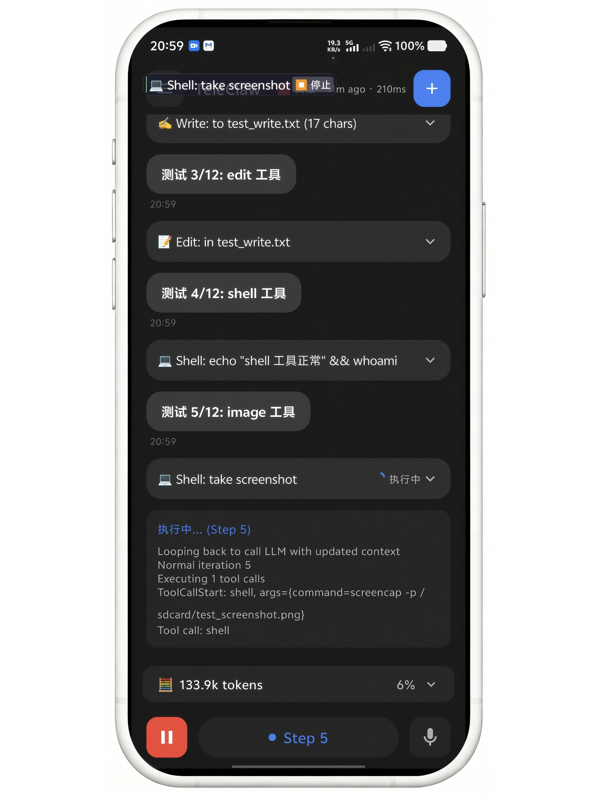
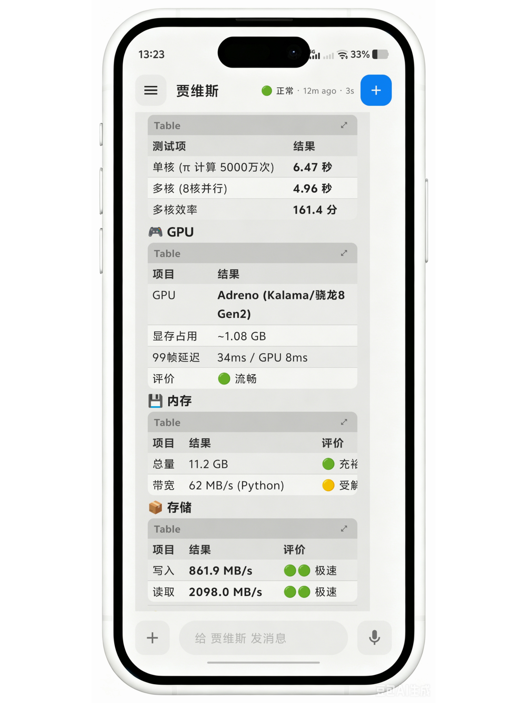

# 🤖 TeleClaw - AI Agent for Android

> Your intelligent mobile assistant with on-device AI capabilities

---

## ✨ Features

- 🧠 **AI Agent** — Intelligent conversation and task execution
- 📱 **Phone Control** — Automated device operation with built-in permissions
- 🖥️ **Virtual Display** — Background app automation
- 🛠️ **Tool System** — File operations, shell commands, web fetch and more
- 💾 **Memory System** — Persistent conversation context across sessions
- ⏰ **Scheduled Tasks** — Cron-like automation for recurring jobs
- 🔒 **Privacy First** — On-device processing, your data stays on your phone

## 📲 Download

**最新版（始终指向最新版本，无需在此查看历史）**

👉 **[⬇️ Download Latest APK](../../releases/latest)**

🌐 官网下载：<https://teleclaw.info/download/teleclaw-latest.apk>

> Minimum Android 8.0 (API 26) · 完全离线运行

## 📸 Screenshots

<div align="center">
  
  
</div>

## 🏗️ Architecture

TeleClaw uses a modular agent architecture designed for mobile:

```
┌─────────────────────────┐
│        UI Layer          │   Jetpack Compose
├─────────────────────────┤
│      Agent Core          │   Conversation loop & orchestration
├──────────┬──────────────┤
│  Memory   │    Tools     │   Semantic search · Shell · File · Web
├──────────┴──────────────┤
│   Platform Services     │   Built-in permission system
├─────────────────────────┤
│      VLM Client          │   OpenAI-compatible API
└─────────────────────────┘
```

## 🔧 Build from Source

> ⚠️ **Note:** Some proprietary modules are not included in this repository.
> The source code provided is the open framework. For the full experience,
> download the pre-built APK from [Releases](../../releases/latest).

```bash
git clone https://github.com/tmzmessi/teleclaw.git
cd teleclaw
./gradlew assembleDebug
```

## 🤝 Contributing

We appreciate your interest! At this time, we are not accepting code contributions as the core agent modules are proprietary. Bug reports and feature requests are welcome via [Issues](../../issues).

Please read [CONTRIBUTING.md](CONTRIBUTING.md) for guidelines.

## 📄 License

```
Copyright 2026 TeleClaw

Licensed under the Apache License, Version 2.0 (the "License");
you may not use this file except in compliance with the License.
You may obtain a copy of the License at

    http://www.apache.org/licenses/LICENSE-2.0

Unless required by applicable law or agreed to in writing, software
distributed under the License is distributed on an "AS IS" BASIS,
WITHOUT WARRANTIES OR CONDITIONS OF ANY KIND, either express or implied.
See the License for the specific language governing permissions and
limitations under the License.
```

---

## ❤️ Support Us

If you like TeleClaw, please consider supporting our development!

- ☕ [爱发电](https://www.ifdian.net/a/teleclaw)
- 🪙 Web3: BTC / ETH / SOL

---

<div align="center">
  Made with ❤️ by TeleClaw Team
</div>
